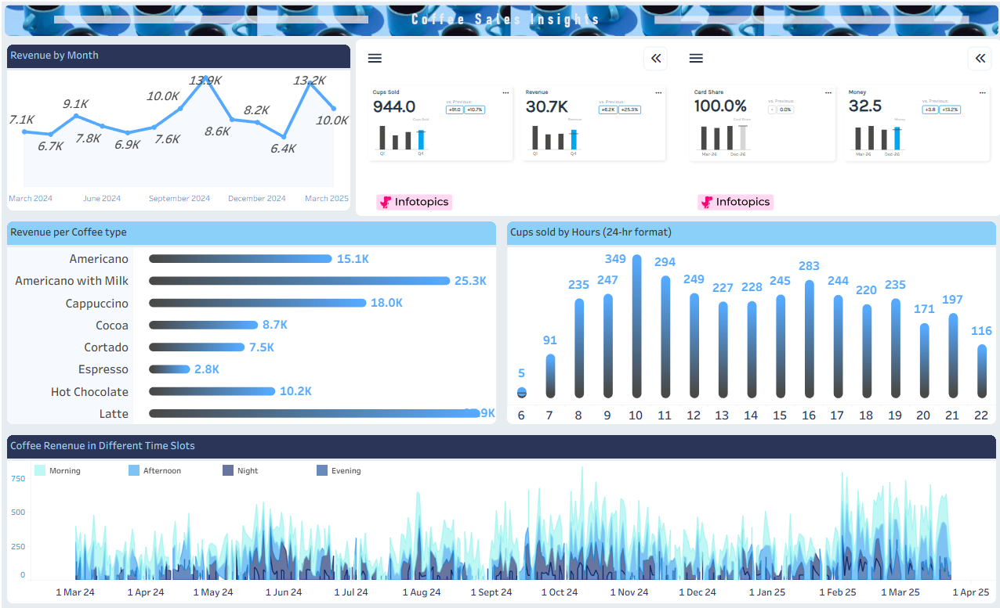

# Coffee Sales Insights | Tableau Business Analysis

**Saksham Chauhan · Analyst Club Friday Challenge participation**

A Tableau dashboard exploring coffee vending-machine sales: which drinks generate revenue, when demand peaks, and how sales vary over time. This portfolio connects the dashboard's findings to replenishment, maintenance and payment-service decisions.

## Business questions answered

| Business question | Answer from the dashboard, verified against its source | Decision it supports |
|---|---|---|
| Which drinks generate the most revenue? | Latte leads with **27,866.30**, followed by Americano with Milk at **25,269.12**. Together they contribute **46.03%** of revenue. | Prioritise ingredient availability for these drinks; assess margins before changing the product mix. |
| When is the machine busiest? | **10:00–10:59** leads with **349 cups**; 11:00 follows with 294 and 16:00 with 283. | Refill before the morning peak; consider a stock check before the afternoon peak. |
| Which month performs best? | **October 2024** leads revenue at **13,891.16**; February 2025 follows at **13,215.48**. | Investigate the conditions behind strong months before using them as planning assumptions. |
| How does revenue vary within the day? | The dashboard's time-slot view separates morning, afternoon, evening and night. Morning (06:00–12:59) contributes **39.03%** of revenue. | Use time-slot demand to plan servicing windows and monitor availability. |
| How important is card payment availability? | Source verification shows **97.24% of revenue** was paid by card. The current workbook's Card Share field measures cup share instead; see the validation note. | Treat card-terminal uptime as a priority; this does not establish customer preference. |

## Dashboard preview

*Original dashboard screenshot. The embedded KPI panels display a narrower/different scope from the full-period charts. Use the verified full-period KPIs below for the project-wide baseline; see [validation notes](VALIDATION.md).*

## Verified full-period KPIs

**1 March 2024–23 March 2025 · 8 drink types · one row = one cup**

| KPI | Result | Definition |
|---|---:|---|
| Revenue | 115,431.58 | Sum of money |
| Cups sold | 3,636 | Row count |
| Average price per cup | 31.75 | Revenue / cups |
| Card revenue share | 97.24% | Card revenue / total revenue |

Amounts use the machine's unspecified local currency, with no currency symbol. March 2025 is a partial month.

## Business recommendations

1. **Protect availability of the leading drinks.** Latte and Americano with Milk dominate revenue, while Americano with Milk leads volume at 824 cups. Track stockout minutes by drink and ingredient wastage to balance service levels with waste.
2. **Align replenishment with demand.** Schedule checks before the 10 a.m. peak and reassess inventory before 4 p.m. Track availability during these windows; hourly sales totals are not evidence of lost sales.
3. **Monitor payment reliability.** Add terminal availability and failed-payment tracking. Retain the cash option pending evidence on customer needs and service costs.
4. **Investigate monthly variation before forecasting.** Check operating days, outages, prices and promotions behind October and February. Compare equivalent periods rather than treating partial March 2025 as a full month.

These are proposed operational actions, not implemented improvements or claimed financial gains. See the [business case](BUSINESS_CASE.md) for decision criteria and follow-up questions.

## Tools and skills demonstrated

- **Tableau:** dashboard design, calculated fields, product revenue comparison, monthly trends, hourly volume and time-slot analysis.
- **Excel:** source dataset supplied for the challenge; this project presents a Tableau adaptation of an Excel-oriented brief, not an Excel PivotTable implementation.
- **Business analysis:** KPI definition, business-question framing, evidence-based recommendations, data validation and communication of limitations.
- **Supporting validation:** a Python script is included for reproducible source checks; it supports the portfolio packaging and does not replace the Tableau dashboard.

## Explore the project

| File | Purpose |
|---|---|
| [Tableau workbook](Coffee_Cups.twb) | Original user-created dashboard |
| [Source dataset](Coffee_Sales_Dataset.xlsx) | 3,636 sales records |
| [Business case](BUSINESS_CASE.md) | Findings, proposed actions and success measures |
| [Validation and opening notes](VALIDATION.md) | KPI scope, formula definitions and Tableau dependencies |
| [Challenge guide](Coffee_Friday_Challenge_Guide.pdf) | Supplied brief |
| [Validation script](validate.py) | Recreate aggregates from the source |

## Open and reproduce

Download/extract the repository, then open `Coffee_Cups.twb` in a compatible Tableau release. The workbook identifies Tableau **2026.2.3** as its source build. Reconnect its Excel source to `Coffee_Sales_Dataset.xlsx`. The original workbook also refers to a local Hyper extract that was not supplied; recreate the extract from Excel if Tableau requests it. Its Infotopics Power KPIs extension may require network access and extension approval. The workbook has not been run in Tableau in this packaging environment.

For independent numeric verification: `pip install -r requirements.txt`, then `python validate.py` from the repository root.

## Credits and interpretation

- Challenge: **Analyst Club**, based on the attached Friday Challenge guide. [LinkedIn community page](https://www.linkedin.com/company/analystclub).
- Dataset credited by the guide to **Yaroslav Isaienkov**: [Coffee Sales on Kaggle](https://www.kaggle.com/datasets/ihelon/coffee-sales). The supplied snapshot is used here; no claim is made that it is the latest source version.
- Dashboard and portfolio: **Saksham Chauhan**.
- The dataset and challenge materials retain their original owners' rights; no blanket licence is asserted over third-party materials.
- Revenue is not profit. Cup counts are not unique customers. Payment shares do not prove preference. Sales patterns do not establish causation or quantify unmet demand.
